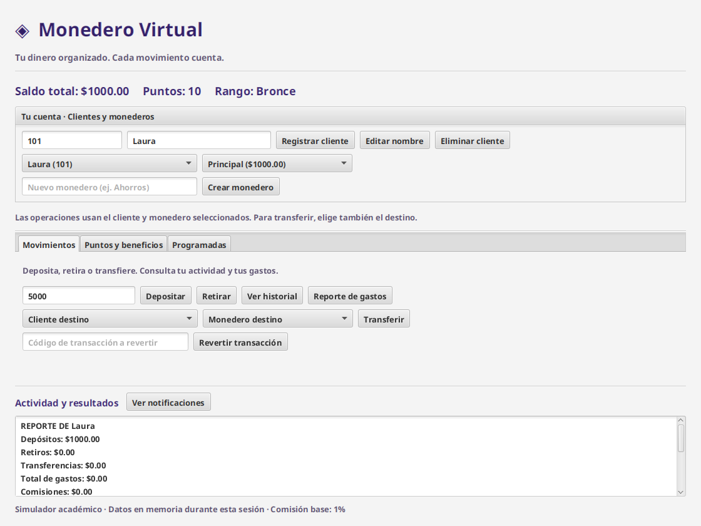

# ◈ Monedero Virtual

Proyecto final de Programación I · JavaFX, FXML y programación orientada a objetos.

Un simulador de escritorio para administrar clientes, separar ahorros y gastos, transferir dinero y convertir movimientos en puntos.



## Ejecutar

Requisito: **JDK 21** (incluye compilador), conexión para la primera descarga y un escritorio gráfico.

Abre `pom.xml` como proyecto Maven en IntelliJ IDEA y selecciona JDK 21 para el proyecto y Maven. Desde la carpeta del proyecto:

```bash
# Linux y macOS
./mvnw clean javafx:run
./mvnw test
```

```powershell
# Windows
.\mvnw.cmd clean javafx:run
.\mvnw.cmd test
```

También puedes usar `mvn` si tienes Maven instalado. No hace falta descargar JavaFX manualmente: el `pom.xml` usa la misma versión 21.0.6 del ejemplo docente `empresa`.

## Recorrido de demostración

1. Registra a Ana (101) y Luis (102). Selecciona Ana como cliente.
2. Deposita 1000: aparecen saldo 1000, 10 puntos y rango Bronce.
3. Selecciona Luis y su monedero como destino. Transfiere 200: Ana queda con 798 y Luis recibe 200. La comisión es 2.
4. Selecciona Luis y consulta su historial: aparece la transferencia recibida sin puntos adicionales.
5. Regresa a Ana. Usa el código de transferencia para revertirla: se restauran el dinero y los puntos; ambos historiales reflejan la reversión.
6. Crea un monedero Ahorros y realiza un depósito en él. Cambia entre monederos para consultar sus saldos.
7. Para probar una alerta atípica con un cliente nuevo, deposita 100 dos veces y después 1000. Revisa el historial y las notificaciones.
8. En Programadas selecciona depósito, fecha de hoy y frecuencia semanal. El monto se toma de Movimientos. Pulsa Ejecutar vencidas; una segunda pulsación el mismo día no repite el movimiento.
9. Para demostrar beneficios rápidamente, deposita 200000 en un cliente de prueba y revisa Puntos y beneficios.

## Organización, como en el ejemplo `empresa`

```text
src/main/java/co/edu/uniquindio/poo/
├── app/              Main: inicia JavaFX y carga el FXML
├── model/            Clientes, monederos, transacciones y puntos
├── controller/       MonederoController: coordina reglas y validaciones
├── viewcontrollers/  PrincipalViewController: eventos y presentación
└── exceptions/       Tres excepciones personalizadas
src/main/resources/co/edu/uniquindio/poo/fxml/principal.fxml
src/test/java/co/edu/uniquindio/poo/controller/
```

Se emplean clases, herencia, interfaz, listas `ArrayList`, ciclos, condicionales, excepciones, lambda, Stream API, JavaFX y FXML. No se añadieron frameworks de backend, base de datos ni librerías de diseño. La apariencia utiliza propiedades y controles FXML, sin CSS.

## Reglas definidas

| Operación | Puntos por cada 100 unidades completas | Comisión base |
| --- | ---: | ---: |
| Depósito | 1 | 0% |
| Retiro | 2 | 1% |
| Transferencia enviada | 3 | 1% |
| Transferencia recibida | 0 | 0% |

Los montos admiten dos decimales y un máximo de mil millones por operación; se rechazan cero, negativos, infinito y NaN. Se redondean saldo y comisiones a centavos usando las herramientas numéricas básicas del curso.

| Rango, según puntos disponibles | Intervalo | Reducción de comisión de transferencia |
| --- | --- | ---: |
| Bronce | 0–500 | 0% |
| Plata | 501–1000 | 5% |
| Oro | 1001–5000 | 10% |
| Platino | Más de 5000 | 20% |

- **100 puntos:** descuento permanente del 10% sobre la comisión de transferencia después del beneficio de rango. No se cobra un segundo canje si ya está activo.
- **500 puntos:** un mes sin comisión de retiros. Otro canje extiende un mes desde la fecha de vencimiento si sigue vigente.
- **1000 puntos:** bono de 50 en el monedero seleccionado. El bono no genera puntos nuevos.
- **Reversión:** resta los puntos originales y devuelve el dinero y la comisión. Se rechaza si el dinero necesario ya se gastó, si ya fue revertida o si dejaría puntos negativos por canjes previos. Solo el emisor revierte una transferencia.
- **Programadas:** única, semanal o mensual; se procesan todas las ocurrencias vencidas en orden cronológico al pulsar Ejecutar vencidas. Un fallo mantiene la fecha para reintentar en otra pulsación y genera una notificación. No impide procesar las demás operaciones.
- **Alertas:** saldo inferior a 100, programación creada, transferencia recibida y operaciones atípicas.
- **Análisis:** compara el nuevo monto con `promedio + 2 × desviación estándar poblacional` del historial anterior no revertido. Exige al menos dos movimientos anteriores y usa una comparación estricta `>`.

Las tarifas, los beneficios adicionales por rango y el tratamiento de canjes previos a una reversión son decisiones documentadas, pues el enunciado no fija esos detalles.

## Alcance y diferencias frente al enunciado

Los datos viven **en memoria** y se reinician al cerrar. Las alertas son **internas**; no se envían correos, WhatsApp ni SMS. Las programadas requieren pulsar el botón y no corren con la aplicación cerrada. Estos aspectos deben confirmarse con el docente: la mención de notificaciones externas del enunciado no está implementada como integración real.

Las transacciones periódicas usan `plusWeeks` o `plusMonths`; en fin de mes Java ajusta al último día válido. La clasificación usa puntos disponibles, por lo que un canje puede reducir el rango. El historial de puntos conserva ganancias, canjes y reversiones.

## Documentación y validación

- [Informe final](INFORME_FINAL.md): pensamiento computacional, POO, algoritmos y complejidad.
- [Pruebas realizadas](docs/PRUEBAS.md): resultados y recorrido de interfaz.
- [Guía de sustentación](docs/SUSTENTACION.md): cómo explicar las decisiones y ubicar el código.
